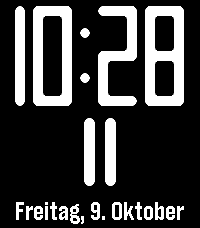
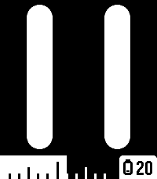
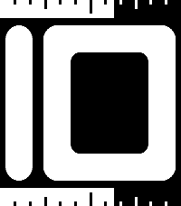
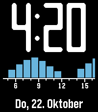
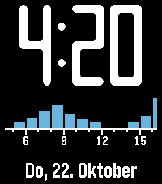
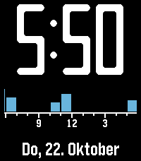

# Norl T2

Watchface für die Pebble Time 2: eine große Stundenziffer, darunter eine Skala, die sich mit den Minuten füllt. Schütteln oder Antippen zeigt für ein paar Sekunden die genaue Uhrzeit und das Datum, groß genug zum Ablesen ohne Brille, dazwischen die Sekunden oder den Regen der nächsten 12 Stunden.

Nachbau von [Norl](https://apps.repebble.com/norl_545cbf8d8d7292ab7a000044) (Matteo Piccina, ursprünglich von Jose Fos, 2014). Das Original ist für 144 × 168 Pixel gebaut und läuft auf der Time 2 nur hochskaliert. Hier sind die Ziffern als Vektoren neu gezeichnet, in voller Auflösung und in frei wählbaren Farben.

Plattform: emery (Pebble Time 2).

         

Die letzten drei Bilder zeigen die Detailanzeige an einem ausgedachten Regentag: um 4:20 Uhr nach Wahrscheinlichkeit, um 4:20 Uhr nach Menge, um 17:50 Uhr im 12-Stunden-Format.

Der Regen ist seit dem 23.10.2026 auf der Uhr getestet und läuft.

## Installieren

`build/norl.pbw` aufs iPhone bringen, etwa per AirDrop, und in der Pebble-App öffnen. Danach auf der Uhr unter „Watchfaces“ auswählen. Für den Regen braucht die Pebble-App Zugriff auf den Standort.

## Bedienung

* **Normalansicht:** Die Stunde füllt den Bildschirm, die Skala am Rand zeigt die Minuten (unten, oben oder an beiden Rändern). Striche alle 5 Minuten, längere bei 15 und 45, der längste bei 30.
* **Lage der Skala** (Einstellung „Skala“): unten, oben (gespiegelt, die Striche hängen von oben herab) oder oben und unten. Oben und unten sind beide Skalen flacher (20 statt 30 Pixel), die Stundenziffer steht dann in der Mitte. Bei niedrigem Akku steht das Akkufeld unten rechts, nur mit der Skala oben steht es oben rechts. Beide Skalen werden dann gleich gekürzt, damit sie gleich weit gefüllt sind. Bei flachen Skalen ist das Akkufeld kleiner.
* **Minuten im ganzen Hintergrund** (Einstellung „Minuten“): Statt der Skala füllt sich der ganze Bildschirm im Lauf der Stunde von links nach rechts in der Farbe der Skalen. Im gefüllten Teil steht die Stundenziffer in der Hintergrundfarbe. Von den Skalen bleiben die Striche alle 5 Minuten, über die volle Breite. Das Akkufeld liegt bei niedrigem Akku über den letzten Strichen, die Skala wird hier nicht kürzer.
* **Niedriger Akku:** Wenn eingeschaltet, ab dem eingestellten Wert (Standard 20 %) wird die Skala kürzer, rechts daneben steht ein farbiges Feld mit Batteriesymbol und dem Ladezustand in Prozent. Beim Laden ist die Anzeige ausgeblendet.
* **Detailanzeige** durch Schütteln (kurz das Handgelenk drehen) oder Antippen: Stunden und Minuten, darunter die Sekunden oder der Regen, unten Wochentag und Datum. Nach der eingestellten Zeit geht es zurück, nochmal schütteln schließt sofort.
* **Regen in der Detailanzeige:** Ein Balken für jede der nächsten 12 Stunden, die volle Breite sind 12 Stunden. Der linke Rand ist jetzt. Darunter steht eine Skala mit einem Strich zu jeder vollen Stunde, alle 3 Stunden länger und mit der Uhrzeit (0, 3, 6 … 21 bzw. 12, 3, 6, 9). Die Balken wandern mit der Zeit nach links, etwa alle 4 Minuten um einen Pixel: Links schrumpft die laufende Stunde, rechts wächst die nächste herein. Je nach Einstellung zeigt die Höhe die Regenwahrscheinlichkeit (ganz oben = 100 %) oder die Regenmenge (1 mm pro Stunde = halbe Höhe, ab 4 mm ganz oben). Unter der Schwelle gibt es keinen Balken. Sind die Daten älter als 3 Stunden, etwa weil das Handy lange weg war, kommen wieder die Sekunden.
* **Antippen** erkennt das Watchface daran, dass das Licht angeht. Touch selbst bekommen Watchfaces auf der Pebble nicht. Deshalb öffnet auch jeder Knopfdruck die Detailanzeige, und Doppeltippen ist nicht möglich. Das Licht öffnet die Anzeige nur, es schließt sie nie. Sie erscheint erst 50 Millisekunden nach dem Licht, damit sie nicht kurz aufblitzt, wenn ein Knopfdruck ein Menü öffnet. Kommen Schütteln und Licht innerhalb einer Sekunde, zählt nur das erste.

## Einstellungen

In der Pebble-App auf dem iPhone beim Watchface auf das Zahnrad tippen.

Oben auf der Seite zeigt eine Vorschau Zifferblatt und Detailanzeige mit den gewählten Farben und Anzeigearten, noch bevor etwas auf der Uhr gespeichert ist. Sie bleibt beim Blättern oben stehen. Gezeigt wird immer 10:38 Uhr mit Akku bei 15 % (falls die Akkuanzeige eingeschaltet ist) und ausgedachtem Regen. Die Farben sind so korrigiert wie im Farbwähler. „Wie in der Uhr eingestellt“ zeigt die Vorschau im 24-Stunden-Format.

| Feld | Standard | |
|---|---|---|
| Hintergrund | Schwarz | |
| Ziffern | Weiß | Stundenziffer und Uhrzeit in der Detailanzeige |
| Skalen, Sekunden und Datum | Weiß | Minutenskala oder Füllung des Hintergrunds, Skala unter dem Regen, Sekunden und Datum |
| Minuten | Skala am Rand | Skala am Rand oder ganzer Hintergrund |
| Skala | Unten | unten, oben oder oben und unten |
| Stunden | wie in der Uhr eingestellt | 12 oder 24 Stunden |
| Detailanzeige öffnen | Schütteln und Antippen | Schütteln, Antippen oder beides |
| Detailanzeige stehen lassen | 10 Sekunden | 5, 10, 15 oder 30 Sekunden |
| Akkustand anzeigen | an | Schalter für die ganze Akkuanzeige |
| Anzeigen | bei 20 % und weniger | bei 10, 15, 20, 25, 30, 40 oder 50 % und weniger |
| Farbe des Felds | Weiß | Feld hinter Symbol und Zahl, die in der Hintergrundfarbe stehen |
| In der Detailanzeige | Regenwahrscheinlichkeit | Sekunden, Regenwahrscheinlichkeit oder Regenmenge |
| Balken ab | 30 % | bei Wahrscheinlichkeit: 10 bis 70 % |
| Balken ab | 0,1 mm pro Stunde | bei Menge: 0,1, 0,2, 0,5 oder 1 mm pro Stunde |
| Farbe der Balken | Hellblau | |

**Farbschemata:** Unter den Farben steht eine Liste mit Schemata. Jedes enthält alle fünf Farben (Hintergrund, Ziffern, Skalen, Akkufeld, Regenbalken), daneben kleine Farbfelder. Antippen übernimmt ein Schema, das zu den eingestellten Farben passende ist mit ✓ markiert. „Farben sichern“ legt die aktuellen Farben unter dem eingegebenen Namen ab, ein vorhandener Name wird überschrieben. „Standard“ (Schwarz und Weiß, Regen hellblau) ist immer da und lässt sich nicht löschen. Neue und gelöschte Schemata bleiben erst nach „Speichern“ erhalten, sie liegen auf dem Handy und gehen nicht an die Uhr.

## Technik

* `src/c/glyphs.c` zeichnet die Ziffern. Jede besteht aus Balken mit runden Enden, angeordnet wie bei einer 7-Segment-Anzeige, die Innenecken werden ausgerundet. Die Maße stammen aus den Bildern des Originals: Strichstärke rund 18 % der Ziffernhöhe, die 1 ist nur einen Strich breit und steht dicht an der Nachbarziffer.
* Beim ganzen Hintergrund liegt eine zweite Ebene über dem Zifferblatt, so breit wie die Füllung. Sie zeichnet dasselbe Zifferblatt mit vertauschten Farben und schneidet es an ihrem rechten Rand ab.
* Bei zweistelligen Stunden werden die Ziffern schmaler und die Striche bei Bedarf dünner, damit die Löcher offen bleiben.
* **Wetter:** Die Uhr fragt das Handy höchstens einmal pro Stunde nach neuem Regen, und nur wenn es verbunden ist. Kommt keine Antwort, fragt sie nach 15 Minuten wieder, beim Wiederverbinden sofort. Das Handy holt bei [Open-Meteo](https://open-meteo.com) (ohne Konto und Schlüssel) Wahrscheinlichkeit und Menge für die nächsten 24 Stunden am Standort des Handys, ohne Standort am zuletzt bekannten. Die Uhr speichert die Daten, ohne Handy zeigt sie sie noch 3 Stunden lang. Der Abruf steht in `src/pkjs/rain.js`.
* `#define RAIN_DEMO 1` in `main.c` setzt statt echtem Wetter einen ausgedachten Tag ein. Die Detailanzeige bleibt dann stehen, Schütteln schaltet durch acht Uhrzeiten (darunter 4:00, 4:20 und 4:40, um das Wandern zu sehen), jeweils nach Wahrscheinlichkeit, nach Menge und im 12-Stunden-Format. Gedacht für Screenshots.
* Das Watchface zeichnet einmal pro Minute neu. Nur solange die Detailanzeige die Sekunden zeigt, läuft es im Sekundentakt; mit Regen bleibt es beim Minutentakt.
* Einstellungen kommen über [Clay](https://github.com/pebble-dev/clay) und werden auf der Uhr gespeichert.
* Die Farbschemata stehen als JSON in einem versteckten Clay-Feld `COLOR_PRESETS`. Clay speichert es mit den übrigen Einstellungen im `localStorage` der Pebble-App und füllt es beim nächsten Öffnen wieder ein. Damit es nicht an die Uhr geht, wertet `src/pkjs/index.js` das Schließen der Einstellungsseite selbst aus (`autoHandleEvents: false`) und nimmt das Feld vorher heraus. Es steht deshalb auch nicht in den `messageKeys`.
* Die Vorschau in den Einstellungen zeichnet `src/pkjs/custom-clay.js` als Nachbau von `main.c` und `glyphs.c` in einem Canvas, mit denselben Maßen. Wer dort etwas an der Zeichnung ändert, muss die Vorschau mitziehen. Schriften sind nur angenähert, weil Gothic im Browser fehlt.

## Bauen

```bash
pebble build
pebble install --emulator emery
pebble emu-tap --emulator emery   # Schütteln simulieren
pebble emu-button --emulator emery click back   # Licht an, wie beim Antippen
pebble emu-battery --emulator emery --percent 20   # niedrigen Akku simulieren
node tools/test/rain_test.js   # Nachricht ans Handy aus einer gespeicherten Open-Meteo-Antwort
node tools/test/config_page.js   # Einstellungsseite samt Vorschau als build/config.html
```

`build/config.html` lässt sich nur über http öffnen, etwa mit `python3 -m http.server -d build 8765` und dann http://localhost:8765/config.html in Handygröße.

Die Uhr speichert den Regen und fragt erst nach einer Stunde wieder. Wer im Emulator einen neuen Abruf sehen will: `pebble kill && pebble wipe`, dann neu installieren.
